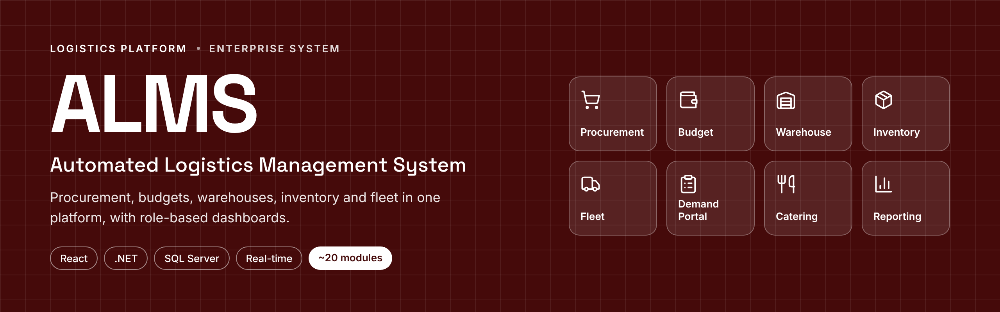
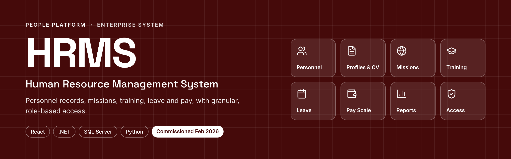

<!-- ══════════════════════════  HEADER  ══════════════════════════ -->
<p align="center">
  
</p>

<p align="center">
  <a href="https://github.com/anishkumar1997">
    
  </a>
</p>

<p align="center">
  
  
  
</p>

<p align="center">
  <a href="mailto:anishkumar.4758z@gmail.com"></a>
  <a href="https://www.linkedin.com/in/anish-anand-kumar-9222a53b4"></a>
</p>

---

## 👋 About me

I'm a **Senior Software Developer** with the **Republic of Fiji Military Forces (RFMF)**, where I've designed, built and documented the internal systems that run logistics and HR across the organisation since **2019**.

- 🏗️ I build **end-to-end platforms**: database design, APIs, front-ends, role-based security, deployment and user manuals
- 📐 I care about the boring-but-vital parts too: **audit trails, RBAC, backups, and documentation people actually read**
- 🤖 Currently exploring **AI-assisted development** and AI features inside business apps
- 🌱 Always iterating: ship a working version, then refine

```ts
const anish = {
  location:   "Fiji 🇫🇯",
  role:       "Senior Software Developer @ RFMF",
  frontend:   ["React", "Tailwind CSS", "Material UI", "Framer Motion"],
  backend:    ["ASP.NET Core", "Entity Framework Core", "SignalR", "REST APIs"],
  data:       ["SQL Server", "Power BI"],
  also:       ["Python", "Mobile apps", "IIS"],
  focus:      "Enterprise systems that replace paper with workflows",
};
```

---

## 🚀 Featured work

<table>
<tr>
<td width="50%" valign="top">



### 📦 ALMS
**Automated Logistics Management System**

A full logistics platform for the RFMF, covering procurement, budgeting, warehouse receipting & issuing, inventory, fixed assets, transport & fleet, the demand portal, rations, QA and reporting.

- 🧩 **~20 modules**, rebuilt from a single-purpose purchase-request tool
- 👥 Role-based dashboards for every type of user
- 🔐 Secure sign-in, granular access control and a full audit trail
- ⚡ Real-time chat & notifications
- 🤖 Built-in AI assistant and user manual

<p>


</p>

<sub>🔒 Private repository · internal system</sub>

</td>
<td width="50%" valign="top">



### 🪖 HRMS
**Human Resource Management System**

A web-based HR system for personnel records, missions & rotations, training, leave, pay scales and reporting. First built in **2020**, rebuilt on a modern stack from **2024**, commissioned **February 2026**.

- 🗂️ Full 360° personnel profiles with CV / PDF export
- 📊 Dashboards, unit reports, Power BI embedding
- 🧮 Spreadsheet bulk-update with AI-assisted field matching
- 🛡️ Granular, role-based access control
- 🖥️ Web app, API and a desktop admin tool

<p>


</p>

<sub>🔒 Private repository · internal system</sub>

</td>
</tr>
<tr>
<td width="50%" valign="top">

### ✈️ Travel Request Form (TRF)
Designed a digital travel-request workflow, delivered as a **49-page scope document** with process flows, UI mockups and role and approval mapping for stakeholders.

</td>
<td width="50%" valign="top">

### 🧭 RFMF Portal
A unified landing page that brings ALMS and HRMS together under one entry point, with dashboards and news. Explored three design directions before settling the layout.

</td>
</tr>
</table>

---

## 💼 Experience

| Role | Organisation | Years |
|---|---|---|
| **Senior Software Developer** | Republic of Fiji Military Forces | 2024 – present |
| **Junior Software Developer** | Republic of Fiji Military Forces | 2019 – 2023 |
| **IT Intern** (IT Cell) | Fiji Sugar Corporation | 2019 |

🎓 **Bachelor of Information Technology**, The University of Fiji (2019)

---

## 🛠️ Tech stack

<p align="center">
  
  <br/><br/>
  
</p>

<p align="center">
  
  
  
  
  
</p>

---

## 📈 GitHub activity

<p align="center">
  
  
</p>

<p align="center">
  
</p>

---

<p align="center">
  <i>"Ship something that works, then make it beautiful."</i>
</p>

<p align="center">
  
</p>
