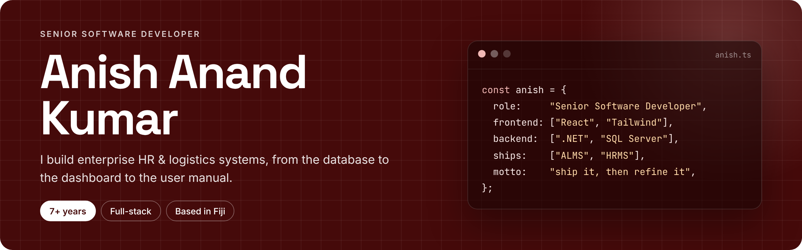
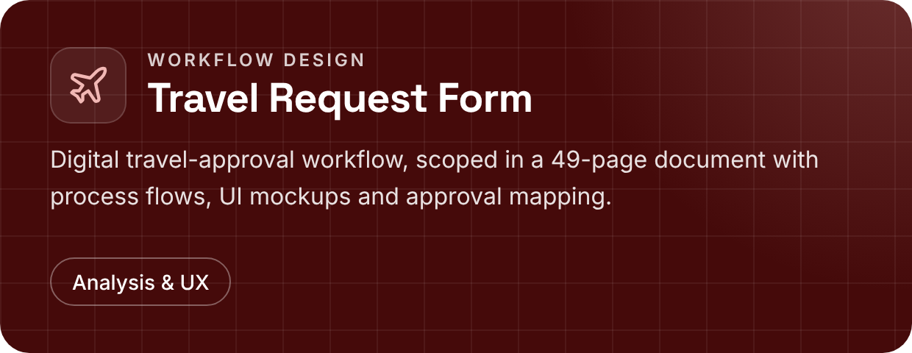
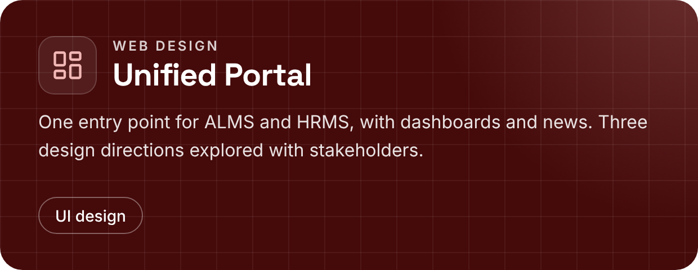

  

  
  
  

 

## About

I'm a Senior Software Developer with the **Republic of Fiji Military Forces**, where I've been building the systems that run HR and logistics across the organisation since 2019.

I own the whole lifecycle: requirements, database design, APIs, front-ends, access control, deployment, and the manuals that get people using the software. I like to ship a working version fast, then refine it with real users.

 

## Featured work

**ALMS** is a logistics platform that grew from a single purchase-request tool into about 20 modules. It covers procurement, budgets, warehousing, inventory, fleet, demand and reporting, with role-based dashboards, real-time notifications and a full audit trail.

 

**HRMS** is the personnel system of record, covering profiles, missions, training, leave, pay and reporting. I first built it in 2020, rebuilt it on a modern stack from 2024, and the new version was commissioned in February 2026.

 

  
  

 

## Experience

| | Role | Organisation |
|:--|:--|:--|
| **2024 – now** | Senior Software Developer | Republic of Fiji Military Forces |
| **2019 – 2023** | Junior Software Developer | Republic of Fiji Military Forces |
| **2019** | IT Intern, IT Cell | Fiji Sugar Corporation |

**Education:** Bachelor of Information Technology, The University of Fiji (2019)

 

## Toolkit

  

SQL Server · Entity Framework Core · REST APIs · Power BI · IIS · Role-based access control · Technical writing

 

## Activity

  
  

 

Built in Fiji · Ship it, then refine it.

